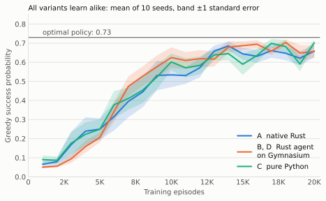

# oxidized-ai-infrastructure

[](https://github.com/me-like-coffee/oxidized-ai-infrastructure/actions/workflows/ci.yml)

Reinforcement learning algorithms from the University of Alberta
[Reinforcement Learning specialization](https://www.coursera.org/specializations/reinforcement-learning)
on Coursera, implemented in Rust and Python and compared. Environments are
either native Rust ports or Python's [Gymnasium](https://gymnasium.farama.org/),
stepped from Rust through [PyO3](https://pyo3.rs/); the Rust agents are also
available to Python as an extension module.

**Scope:** this is a personal learning project, not a competitive offering.
Public Rust crates already cover similar ground, among them
[`rurel`](https://crates.io/crates/rurel) (tabular Q-learning),
[`border`](https://crates.io/crates/border) (an RL library) and
[`gym-rs`](https://crates.io/crates/gym-rs) (Gym environments in pure Rust).
The aim here is to understand the algorithms and the Rust–Python boundary by
building them.

**Status:** the first algorithm, tabular Q-learning on FrozenLake, is
implemented four ways, checked for equivalent learning and benchmarked.

## Results: Q-learning on FrozenLake

The four implementations, on Gymnasium's slippery 4x4 lake:

| | Agent | Environment | Training loop | Time per step |
|---|---|---|---|---|
| **A** | Rust | native Rust FrozenLake | Rust | 0.043 µs |
| **B** | Rust | Gymnasium, through PyO3 | Rust | 7.80 µs |
| **D** | Rust, as the `oxidized_rl` module | Gymnasium | Python | 7.96 µs |
| **C** | Python (NumPy) | Gymnasium | Python | 18.76 µs |



- **They learn the same thing.** B and D produce identical Q-tables; A and B,
  and C and D, agree statistically at every checkpoint across ten seeds.
- **Gymnasium sets the floor.** Its step costs about 8 µs, nearly all of B's
  and D's time, mostly in its NumPy-based slip sampling.
- **Swapping only the agent makes Python training 2.4× faster.** Calling the
  Rust agent from Python costs about 0.5 µs per step, against about 8 µs for
  the Python agent.
- **A native environment removes the floor:** A is about 180× faster than B.

Measured on an Intel Core i9-8950HK under macOS 15.8.2. The
[full write-up](docs/results/q_learning_frozen_lake/2026-11-02_i9-8950hk/README.md)
has the per-component timings, flame graphs, raw data and caveats.

## What's implemented

- **`Environment` trait** ([`core/environment.rs`](reinforcement_learning/src/core/environment.rs)):
  a seeded, fallible `reset`/`step` contract with associated observation,
  action and error types, so algorithms never depend on where an environment
  runs.
- **Native FrozenLake** ([`envs/frozen_lake.rs`](reinforcement_learning/src/envs/frozen_lake.rs)):
  a Rust port of Gymnasium's `FrozenLake-v1`, including its step limit. It
  builds the same transition table as Gymnasium, and parity tests compare the
  two entry by entry.
- **PyO3 gateways** ([`pyo3_gateways/`](reinforcement_learning/src/pyo3_gateways/)):
  wrappers that implement the trait over a `gymnasium.make(...)` environment.
  - `PyO3DiscreteEnvironment`: `usize` observations and actions (e.g. FrozenLake).
  - `PyO3ContinuousEnvironment`: `ndarray::Array1<f64>` observations and
    `usize` actions (e.g. CartPole).

  Python exceptions and unexpected return shapes surface as a typed
  `GatewayError` rather than panics. The gateways sit behind the default
  `gymnasium` feature, so the agents and native environments build without
  Python.
- **Tabular Q-learning** in two languages:
  - Rust ([`agents/q_learning.rs`](reinforcement_learning/src/agents/q_learning.rs)):
    epsilon-greedy with ties broken uniformly at random, generic over any
    discrete `Environment`, with a seeded ChaCha8 generator.
  - Python ([`python/q_learning.py`](reinforcement_learning/python/q_learning.py)):
    a NumPy port written in the style of the course.

  Both bootstrap from the next state when an episode is cut off by the step
  limit, but not when it terminates.
- **Python bindings** ([`reinforcement_learning_py/`](reinforcement_learning_py/)):
  the Rust agent as the Python module `oxidized_rl`, built by
  [maturin](https://www.maturin.rs/) and installed by `uv sync`, with type
  stubs so pyright checks calls into it.
- **Tests**, in Rust and pytest:
  - unit tests with hand-computed Q-learning updates, in Rust and in one
    pytest suite that runs against both the Python and the Rust agent
  - seeded determinism, known transitions and a reusable contract checker for
    the gateways
  - the FFI boundary itself: NumPy `float32` to `f64` conversion, GIL
    contention across threads, and exception propagation
  - golden Q-table fixtures, checking that the variants sharing a random
    stream learn identical tables
  - opt-in statistical tests comparing whole learning curves where the random
    streams differ
- **Benchmark harness** ([`python/benchmark.py`](reinforcement_learning/python/benchmark.py)):
  end-to-end training programs for each variant, criterion and `timeit`
  microbenchmarks, and a runner that follows the methodology below.

## Architecture

```
 Rust: reinforcement_learning crate                Python
┌─────────────────────────────────────┐        ┌───────────────────────────┐
│ QLearning agent                     │        │                           │
│   │ trains on any                   │        │                           │
│   ▼                                 │        │                           │
│ Environment trait                   │        │                           │
│   ├─ FrozenLake (native)        A   │  PyO3  │                           │
│   └─ PyO3DiscreteEnvironment    B ──┼───────▶│ gymnasium FrozenLake-v1   │
└─────────────────────────────────────┘        │   ▲                       │
┌─────────────────────────────────────┐  PyO3  │   │ steps                 │
│ reinforcement_learning_py           │◀───────┼─ train_episode loop       │
│   oxidized_rl.QLearningAgent    D   │        │     ├─ oxidized_rl     D  │
└─────────────────────────────────────┘        │     └─ q_learning.py   C  │
                                               └───────────────────────────┘
```

Each gateway `reset` and `step` acquires the GIL, calls into Gymnasium, and
copies the result into Rust-owned values; the Gymnasium `info` dict is not
passed through. In the other direction, each call from Python into
`oxidized_rl` converts its arguments and runs the Rust agent directly.

### Repository layout

```
.
├── reinforcement_learning/
│   ├── src/core/            # Environment trait
│   ├── src/envs/            # native FrozenLake
│   ├── src/agents/          # tabular Q-learning
│   ├── src/pyo3_gateways/   # Gymnasium wrappers and GatewayError
│   ├── tests/               # integration, FFI, parity and equivalence tests
│   ├── tests/fixtures/      # golden Q-tables
│   ├── examples/            # training program for end-to-end benchmarks
│   ├── benches/             # criterion microbenchmarks
│   └── python/              # Python agent, benchmark harness, charts, pytest tests
├── reinforcement_learning_py/ # Rust agents as the Python module oxidized_rl
├── docs/results/            # published benchmark results and write-ups
├── pyproject.toml           # Python dependencies, tool config, maturin build (uv)
├── Dockerfile               # Rust + Python test image
├── docker-compose.yml       # runs the test suite in the container
└── .github/workflows/ci.yml # CI: build and test on Ubuntu
```

## Getting started

### Prerequisites

Either Docker, or:
- Rust 1.86 or later (the crate uses edition 2024, and its benchmark library,
  criterion, needs 1.86)
- Python 3.11 and [uv](https://docs.astral.sh/uv/); `uv sync` creates a
  `.venv` at the repository root from the pinned versions in `uv.lock` and
  builds the Rust extension module into it

### Build and test

On the host, against `.venv`. PyO3 builds against the interpreter named by
`PYO3_PYTHON` (on Windows, `.venv\Scripts\python.exe`):

```bash
uv sync
export PYO3_PYTHON="$PWD/.venv/bin/python"
cargo test
uv run pytest
```

In Docker, with Docker running:

```bash
docker compose build rl-test       # build the test image
docker compose run --rm rl-test    # run the Rust tests inside it
```

The slow equivalence tests are opt-in. They train the Q-learning agent ten
times per variant and check that the mean learning curves agree at every
checkpoint, then write the curves to `results/` as JSON:

```bash
cargo test --test q_learning_equivalence_test -- --ignored
uv run pytest -m slow
```

CI runs the Python checks, the Rust tests and the slow equivalence tests on
Ubuntu for every push and pull request to `main`. Jobs time out after 15
minutes, so a hung test fails the run rather than holding it for GitHub's
six-hour default.

### Benchmarks

The benchmark harness times the four Q-learning variants: whole training runs
with [hyperfine](https://github.com/sharkdp/hyperfine), and the agent and
environment steps on their own with criterion (Rust) and `timeit` (Python).
It needs hyperfine on `PATH`. On macOS, prefix the run with `caffeinate -d -i`
(see [Preparing a macOS machine](#preparing-a-macos-machine)):

```bash
cargo install --locked hyperfine --version 2.0.0
caffeinate -d -i uv run python reinforcement_learning/python/benchmark.py
```

It writes raw samples, a machine description and `summary.json` to
`results/benchmarks/<UTC time>/`, and exits with an error if any training run's
or microbenchmark's coefficient of variation exceeds 5%.

To publish a run, copy its folder and the equivalence tests' curves
(`results/q_learning_equivalence_*.json`) into a new folder under
`docs/results/`, then draw the charts:

```bash
uv run python reinforcement_learning/python/plot_results.py docs/results/<folder>
```

To see where Python-driven training spends its time, record a flame graph with
py-spy, installed in `.venv` by `uv sync`. On macOS, py-spy needs `sudo`:

```bash
sudo .venv/bin/py-spy record -o profile.svg -- \
  .venv/bin/python reinforcement_learning/python/train_frozen_lake.py python 20000 0
```

## Benchmarking methodology

This section fixes how benchmark results are produced, so numbers stay
comparable between runs and between machines.

### Reference platform

Published numbers come from **macOS, run natively**. Docker on macOS runs
inside a Linux VM, so containerized timings there are not used. Each set of
results records the machine: CPU model and core count, RAM, macOS version, and
the Rust and Python versions, along with the git commit measured.

macOS offers no control over CPU frequency scaling or core pinning, so the
practices below are what keep its numbers stable. Linux allows tighter
control and can be used to check that the relative results hold elsewhere.

### Measurement practice

- **Identical work:** every sample uses fixed seeds and a fixed episode count.
  Native Rust trains for 1,000,000 episodes and the other variants for 20,000,
  because native Rust finishes 20,000 in about 20 ms, too little to time
  reliably against process startup. Variants are compared per training step.
- **Startup subtracted:** each variant also runs with zero episodes, which
  times process launch, Python imports and building the environment. Training
  time is the difference, and its standard error combines both measurements'
  spread.
- **Optimized builds:** Rust uses the workspace release profile
  (`opt-level = 3`, LTO, one codegen unit), including the extension module
  that exposes the Rust agent to Python. All variants use the same Python
  interpreter and the package versions locked in `uv.lock`.
- **Warmup and repeated samples:** hyperfine runs three rounds, each with one
  untimed warmup run and four timed runs per command, so every end-to-end
  measurement has 12 samples. Rust microbenchmarks use
  [criterion](https://github.com/criterion-rs/criterion.rs)'s statistical
  sampling (100 samples), and Python microbenchmarks repeat `timeit` runs (30
  samples). Results report the mean and standard deviation along with the
  median and minimum. The median resists outliers from background activity.
- **Spread check:** a training run or microbenchmark whose coefficient of
  variation exceeds 5% is discarded and repeated after the source of noise is
  found. Startup's spread is reported but not checked: launching a process on
  macOS varies by a millisecond or more between runs, and startup enters the
  results only through the subtraction above.
- **Representative microbenchmarks:** action choice is timed on a Q-table with
  one best action per state, as after early training. On an all-zero table
  every action ties, and tie-breaking takes a slower path that training rarely
  hits.
- **Interleaved variants:** each round rotates the order of the commands, so
  slow drift (heat, background load) affects every variant equally.
- **Separated components:** besides end-to-end training, microbenchmarks time
  each part on its own: the Rust and Python agents' updates and action
  choices, the Rust agent called from Python, the Rust environment step, and
  the Gymnasium step, both directly and through PyO3.
- **Raw data kept:** raw samples (hyperfine JSON, criterion's samples) are
  committed with the machine description, so every published number can be
  traced and recomputed. Paths are recorded relative to the repository.
- **Ratios across machines:** absolute timings differ between machines;
  comparisons across platforms use the ratios between the four variants.

### Preparing a macOS machine

- Run on AC power with Low Power Mode off.
- Quit other applications, including Docker Desktop, whose Linux VM keeps
  running in the background. Pause backups and cloud sync, and let Spotlight
  finish indexing.
- Keep the machine and its display awake for the whole run by prefixing
  commands with `caffeinate -d -i`. `-i` alone stops the system from sleeping
  but not the screen saver, which can start mid-run: an animated one slowed a
  run on the reference Mac by 1.65× for 90 seconds.

### Running on Linux or a cloud machine

1. Install the toolchain:

   ```bash
   # Rust 1.86 or later
   curl --proto '=https' --tlsv1.2 -sSf https://sh.rustup.rs | sh

   # uv, then Python 3.11 and the locked packages in .venv at the
   # repository root; uv sync also builds the Rust extension module
   curl -LsSf https://astral.sh/uv/0.13.6/install.sh | sh
   uv sync --locked
   export PYO3_PYTHON="$PWD/.venv/bin/python"

   # hyperfine, the end-to-end timing tool
   cargo install --locked hyperfine --version 2.0.0
   ```

   Confirm the setup with `cargo test` and `uv run pytest`.

2. Reduce noise:

   ```bash
   # Hold the CPU at a fixed frequency policy
   sudo cpupower frequency-set --governor performance

   # Pin the benchmark run to one core
   taskset -c 2 uv run python reinforcement_learning/python/benchmark.py
   ```

   Optionally disable turbo boost (the method depends on the CPU frequency
   driver) and stop nonessential background services.

3. On a cloud machine:
   - Use a dedicated or bare-metal instance type. Burstable or shared-core
     types change speed mid-run as CPU credits run out.
   - Record the instance type, `lscpu` output and `uname -r` with the results.
   - Neighbouring tenants vary between instances, so repeat on more than one
     instance before trusting small differences.
   - Hosted CI runners share hardware: they are fine for checking that
     benchmarks still run, not for published numbers.

## Roadmap

Each algorithm is implemented four ways (native Rust; a Rust agent with a
Gymnasium environment; a Rust agent driven from Python; and pure Python),
checked for equivalent learning behaviour, and benchmarked before the next one
starts.

- [x] Tabular Q-learning on FrozenLake
      ([results](docs/results/q_learning_frozen_lake/2026-11-02_i9-8950hk/README.md))
- [ ] Further algorithms from the specialization

## License

MIT. See [LICENSE](LICENSE).
