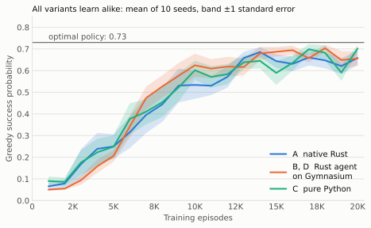
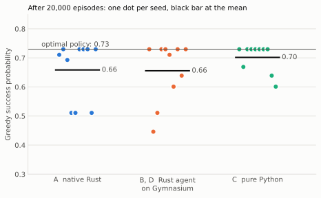
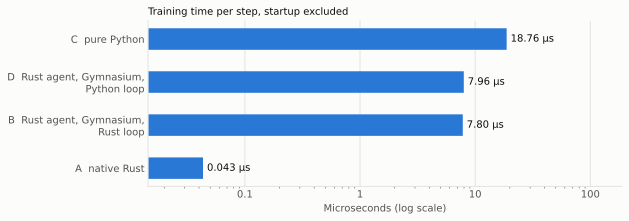
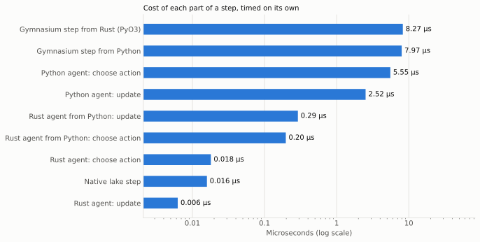

# Q-learning on FrozenLake: four implementations compared

Tabular Q-learning on Gymnasium's slippery 4x4 FrozenLake, implemented four
ways:

| | Agent | Environment | Training loop |
|---|---|---|---|
| **A** | Rust | native Rust port of FrozenLake | Rust |
| **B** | Rust | Gymnasium, called through PyO3 | Rust |
| **C** | Python (NumPy) | Gymnasium | Python |
| **D** | Rust, called through the `oxidized_rl` extension module | Gymnasium | Python |

All four use the same settings: epsilon 0.1, step size 0.02, discount 0.9,
and Gymnasium's 100-step episode limit.

## They learn the same thing



Each variant trained ten times (seeds 0–9) for 20,000 episodes. Every 1,000
episodes the greedy policy was scored by its exact probability of reaching
the goal within 100 steps, computed from the transition table rather than by
playing games.

- **B and D are identical**, value for value, across all 10 seeds and 20
  checkpoints: the same Rust agent on the same Gymnasium environment, whether
  Rust or Python drives the loop. A golden Q-table test checks this exactly.
- **A matches B, and C matches D, statistically.** Their random streams
  differ, so runs differ, but the mean curves agree at every checkpoint. The
  largest gap is 1.6 standard errors for A vs B, and 1.9 for C vs D. The
  test fails beyond 5.



The line at 0.73 is the success probability of the best policy for a
discount of 0.9, found by value iteration. Q-learning maximizes the
discounted return, so this is its target. The policy with the highest
success probability (0.744) takes longer, safer routes that discounting
penalizes. Half or more of each variant's seeds reach 0.73 exactly; the
others settle on slightly worse policies.

| Variant | Mean final score | Seeds at 0.73 |
|---|---|---|
| A | 0.659 | 5 of 10 |
| B, D | 0.656 | 5 of 10 |
| C | 0.702 | 7 of 10 |

C's higher mean is within the spread between seeds: its curve stays within
1.9 standard errors of D's throughout.

## Training speed



| Variant | Time per step | vs pure Python | Steps timed |
|---|---|---|---|
| A: native Rust | 0.0433 ± 0.0001 µs | 433× faster | 26,261,781 (1,000,000 episodes) |
| B: Rust agent, Gymnasium, Rust loop | 7.80 ± 0.04 µs | 2.40× faster | 425,388 (20,000 episodes) |
| D: Rust agent, Gymnasium, Python loop | 7.96 ± 0.03 µs | 2.36× faster | 425,388 (20,000 episodes) |
| C: pure Python | 18.76 ± 0.09 µs | 1× | 501,837 (20,000 episodes) |

Errors are one standard error. Startup (process launch, Python imports,
building the environment) is timed separately and subtracted. A trains for
more episodes because 20,000 take it only about 20 ms, too short to time
against startup.



| Part of a step | Time |
|---|---|
| Gymnasium step, from Rust through PyO3 | 8.27 µs |
| Gymnasium step, from Python | 7.97 µs |
| Python agent: choose action | 5.55 µs |
| Python agent: update | 2.52 µs |
| Rust agent from Python: update | 0.29 µs |
| Rust agent from Python: choose action | 0.20 µs |
| Rust agent: choose action | 0.018 µs |
| Native lake step | 0.016 µs |
| Rust agent: update | 0.006 µs |

What the parts show:

- **Gymnasium dominates B and D.** Its step costs about 8 µs, nearly all of
  their time per step, so the language of the loop barely matters (B and D
  differ by 2%). With Gymnasium, about 8 µs per step is the floor.
- **Replacing only the agent makes Python training 2.4× faster.** The Python
  agent spends about 8.1 µs per step. Calling the Rust agent from Python
  costs about 0.49 µs, and most of that is the crossing into Rust: the Rust
  work itself is about 24 ns.
- **A native environment removes the floor.** A is about 180× faster than B.

The parts roughly add up. For C they come to 16.0 µs against 18.8 µs
measured; the rest is the Python training loop. For B and D they exceed the
measurement by about 0.5 µs: the environment microbenchmark cycles through
the four actions, which ends episodes after about 7 steps where training
averages 21, so it pays for more resets per step.

## Where Python spends its time

Flame graphs recorded with py-spy at its default 100 samples per second,
20,000 episodes each. Open them in a browser to explore:

- [C: pure Python](profile_python.svg)
- [D: Rust agent driven from Python](profile_rust_from_python.svg)

| Share of samples | C: pure Python | D: Rust agent from Python |
|---|---|---|
| Gymnasium `env.step` | 38% | 87% |
| of which Gymnasium's slip sampling (`categorical_sample`) | 30% | 71% |
| Agent: choose action | 32% | 0.9% |
| Agent: update | 18% | 1.5% |

The profiles agree with the microbenchmarks: in C the agent takes half the
time, and in D almost none. They also show where Gymnasium's 8 µs goes. Most
of it is `categorical_sample`, which picks the slip outcome by running NumPy
`cumsum` and `argmax` over an array of three probabilities. At that size,
NumPy's per-call overhead outweighs the arithmetic.

## Method

Measured following the project's benchmarking methodology:

- Release builds, fixed seeds and episode counts.
- hyperfine 2.0.0 ran three rounds with the variant order rotated, each with
  one warmup and four timed runs per command: 12 samples per measurement.
- Microbenchmarks used criterion (Rust, 100 samples) and `timeit` (Python,
  30 samples).
- Every training run and microbenchmark had a coefficient of variation
  between 0.5% and 2.6%, under the 5% limit.

Run with:

```bash
caffeinate -d -i uv run python reinforcement_learning/python/benchmark.py
```

The learning curves come from the slow equivalence tests
(`cargo test --test q_learning_equivalence_test -- --ignored` and
`uv run pytest -m slow`) at commit `106daba`. The timings come from commit
`749e272`. The agents and tests are unchanged between the two. Charts are
drawn by `reinforcement_learning/python/plot_results.py`. In the raw files,
`<repo>` stands for the repository's absolute path on the measuring machine.

## Machine

| | |
|---|---|
| CPU | Intel Core i9-8950HK, 6 cores / 12 threads, 2.9 GHz |
| Memory | 32 GB |
| OS | macOS 15.8.2, x86_64 |
| Toolchain | Rust 1.99.1, Python 3.11.18 |
| Power | AC, Low Power Mode off |

## Caveats

- **One machine.** Absolute times differ elsewhere; the ratios between
  variants are the portable result.
- **Thermal pressure.** macOS reported moderate thermal pressure once during
  the run. Timings stayed steady (training runs varied by at most 1.8%), but
  this laptop was near its thermal limit under sustained load.
- **Background software.** Bitdefender antivirus was running. It may scan
  each process launch, which lands mostly in the subtracted startup time.
- **Two earlier runs were rejected.**
  - The first timed action choice on an all-zero Q-table, where every action
    ties and NumPy's slower tie-breaking path runs on each call. It also gave
    native Rust too short a run.
  - The second was slowed by 1.65× for 90 seconds when the macOS screen
    saver started mid-run; `caffeinate -i` does not prevent it, so the run
    above used `caffeinate -d -i`.
